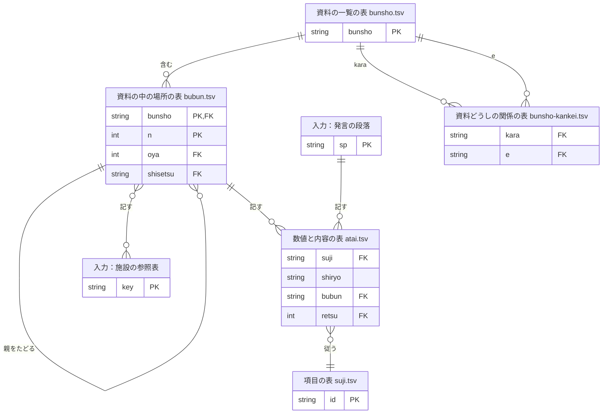
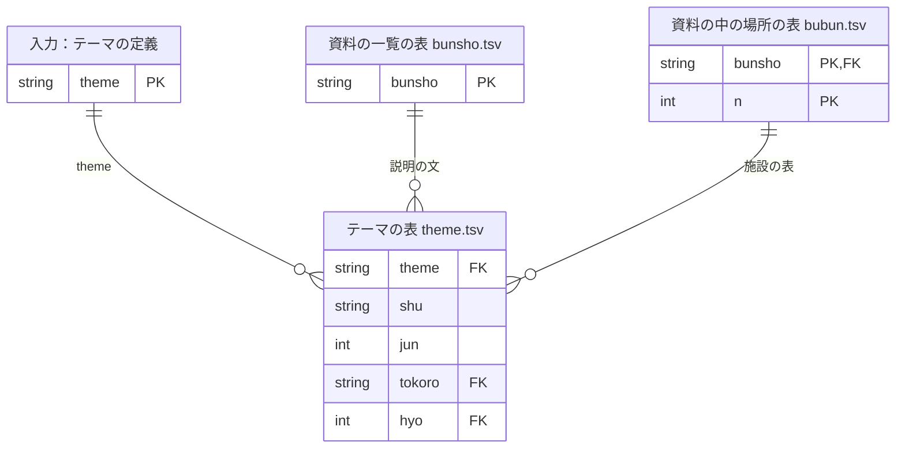

# SCHEMA.md — ID と照合の決まり

このリポジトリが入力を指す ID、引用をもとの資料と照合する決まり、出典の url の作り方を書く。いまは、論点ノートの試作（幼保）で使う物だけを書く。もとは hino-ronten の LINK_SCHEMA.md §2・§4・§5・§15.1（hino-ronten 1c34ba0）。

## 1. 入力の固定 `inputs.lock.json`

- 5つの入力（hino-council-search・shiga-hino-plans・hino-town-docs・council-dashboard・hino-ronten）ごとに、コミットの SHA（40桁）と、読むファイルのパターン（files）を書く。`*` は1つの階層の中だけに当たる。
- ツールは、読む前に、5つの入力の作業ツリーの HEAD が lock の SHA と同じかを確認する。違うとき、git のリポジトリでないとき、HEAD が取れないときは、読まずに止める。
- 読むのは lock の SHA の、files に当たるファイルだけ（`git show <SHA>:<path>`）。入力の場所は、環境変数 `HINO_CONTEXT_INPUTS`（既定 `/tmp/inputs`。その下にリポジトリ名の4つ）と `HINO_CONTEXT_RONTEN`（既定 `/home/claude/hino-ronten`）で受ける。
- hino-ronten から読むのは、題材の定義（ref/themes.tsv）、施設の参照表（ref/shisetsu.tsv）、系列の表（ref/lineage.tsv）、事柄の記録（records/kotogara.tsv）、過程の記録（records/katei.tsv）、問いと事項の対応（records/taio.tsv）、施設の記録（records/shisetsu.tsv）である。records の4つの表は、status が confirmed の行だけを使う。題材の定義と施設の参照表には status の列が無く、依頼者が決めた行だけが入っている（施設の参照表は 2026-10-27 と 2026-11-05 に依頼者が確定した。hino-ronten DESIGN.md ADR-23）。
- 過程の記録の確定済みの行のうち、ページと MCP の応答を作る検査で止まる10行（kaigo の step 2・4・5・6・9・12 と chiiki の step 8 は from が空、kaigo の step 8 と chiiki の step 6・10 は sources に議案の ID（gi:）がある）は、出さない（2026-11-27。4つのテーマを MCP に出すときの指示。入力は読むだけなので、行を直さない）。出さない行と理由は tools/ronten.py の1か所に書き、行がその理由に当たらなくなったら、ページと応答を作らずに止まる。出さずに済ませるか、行の出し方を決めるかは、依頼者が決める。
- 系列の表（ref/lineage.tsv。hino-ronten LINK_SCHEMA.md §8）にも status の列は無い。このリポジトリでは、題材の定義の kind「系列」の value（series）から、計画の ID（plan の列。空の行は除く）を引くためだけに使う（7.7）。
- 題材の定義は、画面では「テーマ」と書く（docs/design.md 2節）。この文書の 7.7 では、テーマの定義と書く。

## 2. ID

| ID | 指す物 | 形 | 例 | 元のデータ |
| --- | --- | --- | --- | --- |
| sp | 会議録の発言 | `sp:<sid>` | `sp:0000008211_20241213_0156` | hino-council-search `public/data/index/<年>.json` の sid |
| sp（段落） | 発言の中の段落 | `sp:<sid>/<段落>`、続いた段落は `sp:<sid>/<始め>-<終わり>`（始め＜終わり） | `sp:0000008116_20240917_0015/5-7` | 同じ発言の text |
| iq | 一般質問の問い | `iq:<sid>` | `iq:0000008397_20250310_0285` | 問いの最初の発言の sid |
| sq | 議案の質疑のまとまり | `sq:<sid>` | `sq:0000008397_20250307_0076` | まとまりの最初の発言の sid |
| doc | 町の資料のページ | `doc:<id>/<ページ>` | `doc:koho-no792-04/1` | hino-town-docs `data/sources.tsv` の id と、PDF のページ（1から） |
| pt | 計画のもとの資料から取り出した文字のページ | `pt:<id>/<名前>/<ページ>` | `pt:youho/honpen-202503/4` | shiga-hino-plans `data/sources_index.tsv` の id と file（拡張子を除いた名前）と、ページ（1から） |
| plan | 計画 | `plan:<id>` | `plan:youho` | shiga-hino-plans `data/plans/<id>.json` |
| gi | 議案 | `gi:<会議id>/<議案番号>` | `gi:0000008942/議第115号` | hino-council-search `public/data/gian.json` |
| node | 計画の事業 | `node:<id>/<key>` | `node:jisshi/e008` | shiga-hino-plans `data/plans/<id>.json` の programs の key |
| fa | 施設 | `fa:<英小文字・数字・ハイフン>` | `fa:minamihizusa-yo` | hino-ronten `ref/shisetsu.tsv` の key |

- sid は `<会議id 10桁>_<名前>_<連番4桁>` の形で、`/`・`,`・`:`・空白を含まない。段落の ID は、最後の `/` で sid と段落に分ける。
- 段落の数え方：lock の版の発言の本文（text）を改行（LF）で分け、空か空白だけの部分を除いて、頭から1、2、…と数える。改行の無い本文は段落1つ。hino-council-search の画面の `&p=<段落>` と同じ数え方。
- sp・iq・sq は発言の位置に依存するので、単独では信頼しない。引用か段落が、その発言の本文にあることで確認する（§3）。
- gi・node・plan は、この試作では、題材の定義の字の中に出るだけで、ツールは読まない。
- 施設の ID（fa）は、hino-ronten の施設の参照表の key をそのまま使う。このリポジトリで、新しい施設の ID を作らない。施設は、建物（場所）を1つの単位とし、名前や運営が変わっても同じ施設とする（hino-ronten DESIGN.md ADR-23）。hino-ronten は作業を閉じているので、施設を追加する必要が出たときは、施設の表をこのリポジトリに置き直す（docs/hoshin.md 6節）。そのときに、別の文案にする。

## 3. 正規化と、引用をもとの資料と照合する決まり

正規化（引用と照合する相手の本文の両方にかける。順に）：

1. NFKC 正規化
2. 改行に続く会議録のページ番号（`\n` の後の「数字-数字」）を除く
3. 前後をハイフンで挟んだページ番号（「-数字-」）を除く
4. 空白（全角・半角・改行・タブなど）をすべて除く

照合する相手：

- sp：lock の版の、その発言の本文
- doc：hino-town-docs の `data/text/<id>.txt` か `data/text_raw/<id>.txt` の、そのページの部分（ページは改ページ `\f` で区切る）
- pt：shiga-hino-plans の `data/text/<id>/<名前>.txt` か `data/text_raw/<id>/<名前>.txt` の、そのページの部分
- 2つの層（text・text_raw）のどちらか一方にあればよい

決まり：

- 正規化した引用が、正規化した相手の本文に含まれれば「合った」とする。
- 合わない引用、相手の本文が無い引用（ファイルやページが無い、ID の形が違う）は「合わなかった」とする。合わなかった行が1件でもあれば、ツールはページを作らずに止まり、件数と行を示す。
- 段落の ID は、その発言に、その番号の段落があることを確認する。無ければ同じく止まる。
- 引用の無い記述（資料の ID が空、名前か url が作れない資料）も、出さずに止まる。

## 4. 出典の名前と url

| ID | 名前 | url |
| --- | --- | --- |
| sp | `会議録 <年>年<月>月<日>日 <発言者>`（日付は sid の8桁、発言者は索引の name） | `https://kken78.github.io/hino-council-search/#sid=<sid>`。引用が1つの段落の中にあれば `&p=<段落>` を付ける |
| sp（段落） | リンクの名前は「会議録」 | `https://kken78.github.io/hino-council-search/#sid=<sid>&p=<段落>` |
| iq・sq | （問いの題は題材の定義の字から） | `https://kken78.github.io/hino-council-search/#sid=<sid>` |
| doc | `「<sources.tsv の title>」 <ページ>ページ` | sources.tsv の url に `#page=<ページ>` |
| pt | `<data/plans/<id>.json の meta.name> <ページ>ページ` | sources_index.tsv の url に `#page=<ページ>` |

- 町のサイトでの掲載が終わった資料：hino-town-docs の sources.tsv の archive_url（依頼者が確認した保存版）があれば、同じ url の資料（doc・pt とも）の url を archive_url に置き換える。`#page=` はそのまま付ける。

## 5. 外部の公的な資料 `teigi/gaibu.tsv`

国と県が公開している、制度についての資料（法令、通知、省庁の説明資料、白書）を、次の2つの使い道に限って使う。町の説明の代わりにしない。町の判断の良し悪しを言うために使わない。どの資料を使うか、どの文に注を付けるかは、依頼者が決める。

- 町の資料や答弁に出てくる制度の言葉（名称、率、期間、対象、条件）を確認する注（§8 の仮の表の「注」）
- 数値と内容の表（§6）の、制度の率の行のもとの資料

ID は `ext:<id>/<ページ>`。表の列は id・name（資料の題）・hakkou（発行者。作成した部署まで）・hiduke（資料の日付）・url・kakunin（確認した日。YYYY-MM-DD）・page（ページ）・ji（その資料から引いた字。原文のまま）。1行に引いた字を1つ書き、同じ資料の字は行を分ける。本文は写さず、引いた字だけを持つ。

- 照合：`ext:` をもとの資料にした注の「」の中の字は、この表の同じ id・ページの ji と照合する（§3 の正規化。ji の中に含まれていれば合う）。外部のサイトの今の中身とは照合しない。サイトは中身や場所が変わるので、確認した日を必ず書く。
- 出典の名前は「<発行者>「<題>」（<資料の日付>） <ページ>ページ」、url は表の url。画面では、名前のあとに「<確認した日>に確認」と出し、町の資料と見分けられるようにする。
- ツールの検査：id・name・hakkou・url・kakunin・page・ji のどれかが空、url が https で始まらない、kakunin の形が違う、のどれかなら止まる。

## 6. セマンティック：項目と数値 `teigi/suji.tsv`・`teigi/atai.tsv`

資料に出てくる数値を、2つの表で持つ。

- `teigi/suji.tsv`（項目）：何を数えた数値かを、数値ごとに1行で書く。同じ数値かどうかは、この表で決める。決めるのは依頼者と担当課で、生成AIは案を出すまで。
- `teigi/atai.tsv`（数値）：項目ごとに、いつの数値か・数値・種類・もとの資料を、1行に1つ書く。行は、生成AIとツールが資料から抜き出し、ツールが資料の本文と照合する。

どの論点のページにどの数値を出すかは、この2つの表には書かない（論点の表の形を決めるときに決める）。

### 6.1 項目の表 `teigi/suji.tsv`

| 列 | 中身 | 例 |
| --- | --- | --- |
| id | 項目の id。英小文字・数字・ハイフン | `taiki` |
| name | 数値の名前。資料の言い方から取る | 待機児童数 |
| nani | 何を数えた数値か（対象、基準） | 各年4月の、国の基準による保育所等の待機児童の数（町全体） |
| tani | 単位。無ければ空 | 人 |
| iikata | 資料での言い方。資料によって名前や単位の書き方が違うときは、資料ごとに書く | 待機児童数（再編整備計画）、保育所等待機児童数（総合計画。単位は件） |
| toki | いつの数値として数えるかの決まり。資料によって書き方が違うとき、同じ時の数値として並べてよい範囲を書く | 各年4月1日現在 |
| nendo_tsuki | 年度で書かれた数値を、何月の時点の数値として扱うか。月の数（1〜12）。年度を期間（4月〜翌年3月）として扱う項目は空。時点の関係（7.3）を出すときに使う | 4 |
| sei | 資料の間で数値が一致しないときに、先に出す資料。決めていなければ空 | （空） |
| chui | 注意。別の項目との違い、足し合わせてはいけない種類など | 「待機児童数から除かれる者の小計」とは別の数値 |
| kettei | 依頼者が決めた日（YYYY-MM-DD）。決めていない行は「案」 | 案 |

- 資料に書かれた差や割合（例：確保方策から量の見込みを引いた「不足分」）は、資料の行としてあるものだけを、別の項目として持つ。ツールと生成AIは、差や割合を計算しない。
- kettei が「案」の項目の数値は、画面と MCP で「項目は、まだ案です」と示して出す。

### 6.2 数値と内容の表 `teigi/atai.tsv`

| 列 | 中身 | 例 |
| --- | --- | --- |
| suji | 項目の id | `taiki` |
| kubun | 区分（認定区分、内訳の名前など）。無ければ空 | 2号認定（3〜5歳・保育） |
| jiten | いつの数値か。資料の書き方のまま | 令和7年4月 |
| nendo | 対象の年度（西暦4桁）。並べる順に使う。年度で言えない数値は空 | 2025 |
| atai | 数値。資料の字のまま（「▲5」「なし」「40程度」も字のまま） | 3 |
| shurui | 種類。資料が、その数値について書いている字（目標、実績、見込み、概算など）。資料に字が無ければ空 | 目標 |
| jotai | 状態。6.3 の4つのどれか | 数値がある |
| shiryo | もとの資料の ID（§2） | `pt:youho/honpen/11` |
| inyo | 資料の文。その数値を含む、資料の字のままの短い抜粋 | 令和7年4月 2 2 11 15 3 |
| hani | 調べた範囲と、探し方 | （空） |
| kakunin | 調べた日（YYYY-MM-DD） | 2026-11-19 |
| chu | 確認の状態（PDF で未確認、照合していない理由など）。無ければ空 | （空） |
| bubun | 数値を記している、資料の中の場所（§7）。計画と町の資料は、shiryo の資料の、資料の中の場所の表の番号（行、表、見出しのどれか）。発言は段落の ID（§2）。まだ指していない行は空 | 6 |
| retsu | 表の数値の場合、列の部分の番号（§7）。ほかは空 | 5 |

- 資料の表の欄が、数ではなく文の場合も、その欄を指す行として、この表に持つ。atai に、欄に書かれたとおりに書く。実物の例：所在地（広報ひの 2024年10月号の表）、整備方針・形態・整備後の施設（案）（再編整備計画 27ページの表）。項目の name は、表の列の見出しから取る。
- 欄や見出しの中の改行は、別の語の区切りなら半角の空白1つにし（「子育て支援施設 学童保育所等」）、括弧の前や語の途中なら空白を入れない（「小規模保育施設（民間運営）」）。
- 資料の本文の段落の文も、段落の見出し（7.2）を指す行として、この表に持つ（2026-11-27）。実物の例：項目「再編整備スケジュール」（id は `seibi-sukejuru`。name は、再編整備計画 34ページの節の見出し「４ 再編整備スケジュール」から取った）。この節には、施設の名前を見出しにした段落が6つあり、2つの版で12行を持つ。
  - atai は、段落の見出しの下の文の全体を、資料の字のまま書く（全角と半角も資料のまま）。年度だけを抜き出さない。段落によって述語が違い（「開設を目指します」「移行します」「開設しました」）、年度だけにすると、その違いが消えるためである。
  - inyo にも同じ文を書き、§3 で照合する。bubun は段落の見出しの番号、retsu は空。nendo は空で、jiten は資料の書き方（27ページの表の行と同じ。「2026年6月の再編整備計画（令和８年６月一部改正）」）。
  - 段落の文の、行の折り返し（文の途中の改行）は、空白を入れずにつなぐ。上の項目の「別の語の区切り」は、欄の中に語を並べた所の改行のことで、文の折り返しには当たらない。例：もとの資料から取り出した文字の「令和１０年度に幼保連携型認定こども園への移行準」「備を行い、令和1１年度での開設を目指します。」の2行は、「令和１０年度に幼保連携型認定こども園への移行準備を行い、令和1１年度での開設を目指します。」とつなぐ。
  - 段落の文の中の時期を、別の項目で持つ場合（開園の時期 kaien の再編整備計画の2行）も、その行の bubun は段落の見出しを指す。段落の見出しと、その上の節の見出しで、再編整備計画の時期が、施設ごとのスケジュールの段落に年度で書かれた記述であることが分かるようにし、注の文では書かない。
- 資料の表で、複数の行の欄が1つに結合されている場合は、行ごとに同じ内容を書き、chu に、結合されていることを書く。
- inyo を、もとの資料から取り出した文字のうち、字の並びが崩れた所から取った行（照合には通るが、資料の文として読める並びになっていない行）は、chu に「抽出した文字の並びが崩れている」と書く。この字があるかどうかの判定は、tools/suji.py の inyo_kuzure の1か所で行う（2026-11-27）。画面と MCP での出し方は docs/design.md 3節に書く。
- 同じ項目・同じ時について、資料ごとに数値が違うときは、行を分けて両方を書く。どちらかを消さない。項目の sei が空なら、並べて出す。
- 施設が違う数値は、比較しない（施設ごとに数値を持つ定員などで、施設の違う数値を、一致しない数値として出さない）。施設は、数値と内容の表の行が指す資料の中の場所（bubun の行と retsu の列）の shisetsu で決める。shisetsu が無い数値は、shisetsu が無い数値どうしで比較する。判定は tools/suji.py の1か所で行う。
- 一部改正の前後の、同じ項目の、改正前と改正後の数値の組み合わせ（2026-11-27 の依頼者の決定）：資料どうしの関係の表（7.6）で hyogen が「一部改正」の行の、kara の資料（改正後）と e の資料（改正前）について、jotai が「数値がある」の行を、次の条件で組み合わせる。組み合わせる判定は tools/suji.py の1か所で行う。画面と MCP での出し方は docs/design.md 4節に書く。
  - suji と kubun が同じで、次のどれかに当たる行を組み合わせる。(1) nendo が空でなく、同じで、施設（上の項目と同じ決め方）も同じ（どちらの行にも施設が無い場合を含む）。(2) nendo が空で、施設（上の項目と同じ決め方）が空でなく、同じで、列の見出し（retsu の部分の name）も同じ。(3) nendo も施設も空で、その suji と kubun の行が、2つの資料に1行ずつだけある。
  - 条件に当たる行が、片方の資料に2行以上あるときは、同じページの行どうしを先に組み合わせ、残りが1行ずつなら、それを組み合わせる。
  - 組み合わせた2行の atai が、§3 の正規化のあとで同じなら、出さない。違えば、改正前と改正後で違う数値として出す。
  - 片方の資料にだけある行のうち、(1) か (2) で相手が無いものは、改正後に加わっている数値、または、改正後に無い数値として出す。ただし、同じ資料の中に、suji、kubun、nendo が同じ行がほかのページにあり、その行が相手の資料の行と組み合わされている場合は、出さない。
  - (3) に当たらない行（片方の資料に2行以上ある）は、組み合わせない。ツールは、組み合わせなかった行の数を、作成のときに出す。
  - 実物の例（再編整備計画の2025年3月と、令和8年6月一部改正）：違う数値は、開園の時期（kaien）の1組（令和10年度、令和11年度）と、再編整備スケジュールの5組（34ページの、西大路幼稚園、保育所こばと園、保育所あおぞら園鎌掛分園、南比都佐幼稚園、保育所あおぞら園・日野幼稚園・必佐幼稚園・桜谷こども園第１園舎の段落）で、どれも条件 (2)（開園の時期の2行は、5つめの段落の見出しを指すので、施設がある。2026-11-27 までは、節の見出しを指していて、条件 (3) だった）。加わっている数値は、待機児童数（taiki）と、待機児童数から除かれる者の小計（nozoku）の、2025年度の1行ずつ。同じ数値は、taiki の7組、nozoku の7組（条件 (1)）と、27ページの表の4つの項目の36組と、再編整備スケジュールの1組（桜谷こども園第２園舎の段落。全角と半角の違いだけ）（条件 (2)）。改正前の21ページの nozoku の1行（2024年度）は、11ページに同じ年度の行があって組み合わされるので、出さない。
- 目標と実績、見込みと実績は、同じ項目の行として持つ。画面と MCP で対にして並べるときは、shurui ではなく、次の2つで分ける（2026-11-21 の依頼者の決定）。
  - 対象の時点と資料の日付の関係（7.3。ツールが出す）。
  - 資料の中の場所（7.2。表の列の見出しなど、資料の字）。
- 資料の中の場所をまだ指していない行（bubun が空）は、shurui の字で分ける。
- shurui には、資料の字だけを書く（2026-11-21 の依頼者の決定）。資料に種類に当たる字が無ければ、空にする。資料の字は、その数値について書かれた字に限る。同じページの別の行や、別の数値についての字を書かない。こちらの説明は chu に書く。資料の版や時期の違いから、こちらで「変更」と書かない。変わったことは、資料が「見直した」「変更した」と書いているときに、その資料の字で持つ。
- 会議録の発言を shiryo にした行も持つ（2026-11-21 の依頼者の決定）。次の3つを守る。
  - inyo は、文の途中で切らない。数値を含む文を、文の頭から「。」まで引く。
  - shurui は、発言の言い方から取る（「目標」「見込み」「聞いている」など）。こちらで付け替えない。
  - 伝聞や概数は、そのまま持つ（「おおむね8億」「40名程度」）。丸めない。確定の数値として扱わない。
- 項目の違う数値を、同じ数値として並べない。並べるときは、項目の名前を付けて分ける。

### 6.3 状態

| 状態 | 意味 | 必ず書く列 |
| --- | --- | --- |
| 数値がある | 資料に数値が書かれている | atai・shiryo。inyo を書けないときは、chu に理由と、確認の記録 |
| 欄が空 | 資料にその欄があり、数値が書かれていない | shiryo。atai は空 |
| 数値を示さない説明がある | 答弁や資料が、未定、今後決めると説明している | shiryo・inyo。atai は空 |
| 調べた範囲に見つからない | 範囲を決めて探し、見つからなかった | hani・kakunin。atai は空 |

- suji（項目の id）・jiten（いつの数値か）・jotai（状態）の3つの列は、どの状態でも必ず書く。
- 表に行が無い数値は、まだ調べていない数値として扱う。画面と MCP で「無い」と書かない。
- 「調べた範囲に見つからない」の行は、hani に、探した入力（会議録の期間、資料の種類、計画の版）と、探した語を書く。
- `inputs.lock.json` の版を進めたら、「調べた範囲に見つからない」の行を探し直す。探し直すまで、その行は出さない。
- 広報ひの（hino-town-docs の sources.tsv で category が koho の資料）を shiryo にした「数値がある」の行は、依頼者が PDF で数値を確認してから入れる。chu に「人が PDF で確認（YYYY-MM-DD）」と書く。広報ひのは、取り出した文字の数値をそのまま出典にしない。
- inyo を書けない「数値がある」の行（もとの資料から取り出した文字が入力に無いか、文字として取り出されていない図や表の数値）は、次のどちらかの確認をしてから入れ、chu にその字を書く。構造化したデータの値や、文字の読み取り（OCR）の下書きの値を、確認なしに出典にしない。
  - 依頼者が PDF で数値を確認する。chu に「人が PDF で確認（YYYY-MM-DD）」と書く。
  - 生成AIが、もとの資料の PDF のページの画像を、互いの読みを見ずに2回読み、数値が一致する。chu に「生成AIが画像を2回読んで一致（YYYY-MM-DD）」と書く。
- 確認の記録の字は、画面と MCP の応答にそのまま出るので、読む人に通じる字にしている（2026-11-27 に、「依頼者が PDF で確認」を「人が PDF で確認」に、「2者が画像で確認」を「生成AIが画像を2回読んで一致」に改めた。7.2 の記録も同じ）。
- 生成AIの2回の読み取りによる確認の条件（2026-11-23 の依頼者の決定）：(1) 読む PDF の sha256 が、入力の台帳と一致する。(2) 2回は、別の文脈で読む（相手の読み、構造化したデータ、OCR の下書きを見ない）。(3) 数値、単位、その数値の行と列の見出しが、2回の読み取りで一致する。(4) どちらも、不確かと書いていない。1つでも欠ければ、依頼者が PDF で確認するまで入れない。
- 実物の例：総合計画の基準値(R1) 1 は、依頼者が PDF で確認した（2026-11-20）。提言8ページの図の日野町の2018年の出生率は、読んだ者が不確か（1.58か1.50）としたので、条件(4)を欠き、入れない。

### 6.4 ツールの検査

次のどれかがあれば、ページと MCP の応答を作らずに止まる。件数と行を示す。

- 表が片方しか無い（両方とも無いときは、表がまだ無いものとして、止めない）。
- 表の列名の行が、6.1・6.2 と違う（列が足りない、余分な列がある、順が違う）。行の列の数が違う。
- 項目の表で、id・name・nani・kettei のどれかが空。id の形が違う。kettei が、日付（YYYY-MM-DD）でも「案」でもない。
- 項目の id が重なっている。数値の行の suji が項目に無い。
- jotai が 6.3 の4つのどれでもない。必ず書く列が空。atai を空にする状態で、atai に字がある。
- shiryo の ID の形が、§2 と違う。inyo があって、shiryo が空。
- inyo が、shiryo の資料の本文に無い（§3 の正規化と照合）。
- 「数値がある」の行で、atai の数字の部分（符号、桁区切りの「,」、小数点を含む）が、inyo の中に、1つの数として書かれていない。別の数の一部として含まれているだけの場合（atai が 40、inyo が 140）は、書かれていないものとする。atai に数字が無い行（「なし」など）は、この検査の対象にしない。
- 「数値がある」の行で、shiryo が広報ひのであるのに、chu に「人が PDF で確認（YYYY-MM-DD）」の字が無い。
- 「数値がある」の行で、inyo が空であるのに、chu に「人が PDF で確認（YYYY-MM-DD）」と「生成AIが画像を2回読んで一致（YYYY-MM-DD）」のどちらの字も無い。
- 上の2つとも、日付の形が違う場合は、無いものとする。
- shiryo が発言（sp）の行で、inyo が、その発言の本文の、文の頭から「。」までになっていない。文の区切りは、発言の本文を改行と「。」で分けたものとする。
- shurui が空でない行で、その字が、shiryo のページ（発言はその発言）のもとの資料から取り出した文字に無い。もとの資料から取り出した文字が入力に無い資料の行は除き、除いた行の数を出す。
- kakunin の形が違う。nendo が西暦4桁でない。
- 項目の表の nendo_tsuki が、空でも、1〜12の数でもない。

### 6.5 まだ決めていない点

- 計画ライブラリ（shiga-hino-plans）の構造化済みの表を、セルごとに指す ID は無い。計画の表の数値は、もとの資料から取り出した文字の表の行と列を、資料の中の場所（§7）として指す。
- 総合計画の原文の文字が入力に無い。総合計画の数値は、依頼者が PDF で確認したものだけを持つ（6.3）。入力の側でもとの資料から取り出した文字ができたら、inyo を書いて照合する。
- 画面で、種類（目標・実績など）をどう見せるかは、ページの構成を決めるときに決める。
- 依頼者が確認したことは、いまは chu の字で持つ。当たる行が増えたら、確認した人と日の列を足すかを、比較して決める。

## 7. オントロジー：資料と、資料の中の場所 `teigi/bunsho.tsv`・`teigi/bubun.tsv`・`teigi/bunsho-kankei.tsv`・`teigi/theme.tsv`

方針の文書の 4.2 の、物の種類「資料と、資料の中の場所」と、関係「資料が、事項について記す」を、表で持つ。数値と内容の表（§6）の行は、「資料の中の場所が、項目について、ある時点の数値を記す」という関係を1つ書いたものとして扱い、引用の字とページだけでなく、資料の中の場所を指す（2026-11-21 の依頼者の決定）。

数値が何を指すかは、項目の表（6.1）と、資料の中の場所（どの表の、どの行と列か）で決める。単語が一致することで、数値の意味や種類を決めない。

関係の名前と、持ち方は次のとおり（名前は案）。

| 関係 | 持ち方 |
| --- | --- |
| 資料が、資料の中の場所を含む | 資料の中の場所の表の bunsho と oya（7.2） |
| 資料の中の場所が、数値を記す | 数値と内容の表の bubun と retsu（6.2） |
| 数値が、項目に従う | 数値と内容の表の suji（6.2） |
| 答弁が、問いに答える | 表に書かない。ツールが、入力の質問の区切りの表から出す（7.3） |
| 資料の中の場所が、施設について記す | 資料の中の場所の表の shisetsu（7.2）。施設は、hino-ronten の施設の参照表の ID（§2 の fa）で指す |
| 資料が、資料のもとになる | 資料どうしの関係の表の kara と e（7.6） |
| 資料が、テーマについて説明する | テーマの表で shu が「説明の文」の行の theme と tokoro（7.7） |
| 資料の表が、テーマの施設を並べる | テーマの表で shu が「施設の表」の行の theme と tokoro・hyo（7.7） |

- テーマの範囲（テーマの施設と資料）は、hino-ronten のテーマの定義（ref/themes.tsv）から引き、このリポジトリには持たない。テーマの表（7.7）は、テーマの定義から引けない2つ（説明に使う資料の文と、施設の一覧に使う資料の表）だけを持つ。テーマの表にかかわる関係の図は 7.7 に書く。

- 図の列は、関係にかかわる ID の列だけ。列の中身は 6.1・6.2・7.1・7.2 の表に書く。
- 「答弁が、問いに答える」は、表に書かずにツールが出す関係なので、図に線が無い。

### 7.1 資料の一覧の表 `teigi/bunsho.tsv`

| 列 | 中身 | 例 |
| --- | --- | --- |
| bunsho | 資料の ID。§2 の pt・doc の ID からページを除いた部分か、plan の ID | `pt:kodomo/honpen` |
| namae | 資料の名前。表紙の字のまま | 第３期日野町子ども・子育て支援事業計画 |
| shurui | 資料の種類。町の資料は、入力の台帳（hino-town-docs の data/sources.tsv）の category の字のまま。計画ライブラリの資料（pt・plan の ID）は `keikaku`（2026-11-21 の依頼者の決定） | `keikaku` |
| konkyo | 根拠（法令、手続き、上位の計画）を書いた、資料の字のままの抜粋。資料に記載が無ければ空 | 子ども・子育て支援法第 61 条に基づく |
| konkyo_tokoro | konkyo の字があるページの ID。konkyo が空なら、探したページを chu に書く | `pt:kodomo/honpen/8` |
| hiduke | 資料の日付（YYYY-MM か YYYY-MM-DD）。策定・改正・発行の日 | 2025-03 |
| hiduke_moto | hiduke の字があるページの ID か、入力の台帳の名前 | `pt:kodomo/honpen/1` |
| han | 資料に書かれている、版や改正の表記。もとの資料の字のまま。無ければ空 | 令和８年６月一部改正 |
| han_tokoro | han の字があるページの ID | `pt:youho/honpen/1` |
| chu | 注。無ければ空 | （空） |

- 資料ごとに1行。計画の版は、版ごとに別の行にする（`pt:youho/honpen` と `pt:youho/honpen-202503`）。
- 根拠は、資料に書かれている字から取る。資料に書かれていない根拠を、こちらの知識で補わない。
- shurui に、こちらで付けた名前を書かない。法定の計画かどうか、上位の計画が何かは、konkyo の字で示す。根拠の法令で読み方が変わる資料（監査の報告など）は、その題材を扱うときに、資料の種類ごとの表（根拠、宛先、応答）を足すかを決める。
- 日付の記載が資料に無ければ、hiduke を空にし、探した所を chu に書く。
- namae は、1ページのもとの資料から取り出した文字にあることを、ツールが確認する。総合計画（plan の ID）は、もとの資料から取り出した文字が入力に無いので除く。
- 会議録の発言は、この表に入れない。発言の日・役職・会議の名前は、入力の索引から引く。

### 7.2 資料の中の場所の表 `teigi/bubun.tsv`

| 列 | 中身 | 例 |
| --- | --- | --- |
| bunsho | 資料の ID（7.1） | `pt:youho/honpen` |
| n | 資料の中の番号（1からの整数） | 6 |
| oya | 親の部分の番号。いちばん上の見出しは空 | 4 |
| shu | 見出し、表、行、列のどれか | 行 |
| name | 見出しの字、表の題、行の見出し、列の見出し。もとの資料の字のまま（番号の字も含める）。名前を作らない | 平成30年4月 |
| tokoro | name の字があるページの ID | `pt:youho/honpen/11` |
| jun | shu が列の場合、その表の数値の列を左から数えた順（1から）。ほかは空 | （空） |
| matome | shu が列の場合、その列の上の行にある見出し。複数の列をまとめた見出しのほか、1つの列だけの上にある見出し（基本構想 14ページの表の「計」など）も書く。もとの資料の字のまま。無ければ空 | 待機児童数から除かれる者 |
| shisetsu | その部分（行、列、表、図の中の箱）が記している施設の ID（§2 の fa）。複数あれば「;」で区切る。無ければ空 | `fa:minamihizusa-yo` |
| shisetsu_kakunin | shisetsu を、どう決めたかの記録。name が施設の参照表の name か aliases と一致する行は、空。一致しない行は、確認が済んでいれば「人が確認（YYYY-MM-DD）」か「生成AIが2回読んで一致（YYYY-MM-DD）」。確認が済んでいなければ空 | 人が確認（2026-11-24） |
| torikata | 機械（ツールがもとの資料から取り出した文字から取った）か、読んだ（生成AIが読んで決めた） | 機械 |
| chu | 注。無ければ空 | （空） |

- 持つのは、数値と内容の表の行が指す部分と、その親。ページに出す表（docs/design.md 4節の「資料の表のページ」）は、表の行と列を全部持つ。資料の見出しをすべて入れることはしない。
- 親は、見出し → 見出し → 表 → 行・列 の順にたどれる。行と列の親は表。親は、同じ資料の、番号が小さい行にする。
- torikata が「読んだ」の行は、守ることの7（2回読み、一致したか分かれたかを持つ）に従い、画面と MCP で未確認の印を付けて出す。ただし、次のどちらかの確認をして、chu にその記録を書いた行には、印を付けない。
  - 依頼者が PDF で見出しを確認する。chu に「人が PDF で確認（YYYY-MM-DD）」と書く。
  - 生成AIが、もとの資料の PDF のページの画像を、互いの読みを見ずに2回読み、見出しが一致する。chu に「生成AIが画像を2回読んで一致（YYYY-MM-DD）」と書く。
- 生成AIの2回の読み取りによる確認の条件：(1) 読む PDF の sha256 が、入力の台帳と一致する。(2) 2回は、別の文脈で読む（相手の読み、取り出した文字を見ない）。(3) 見出しが、§3 の正規化のあとで、2回の読み取りで一致し、name とも一致する。(4) どちらも、その見出しを不確かと書いていない。全角か半角かだけの不確かさは、§3 の正規化で区別しないので、数えない。1つでも欠ければ、印を付けたままにする。
- 行と列は、親の表の題のあと、次の表の題の前までの範囲にある字で決める。同じ行の見出しが、1ページに複数あるため（例：子ども・子育て支援事業計画の72ページに「不足分（②－①）」が3つ）。
- 会議録の発言の部分は、§2 の段落の ID（`sp:<sid>/<段落>`）で指すので、この表に入れない。
- shisetsu の判定の条件：その部分の name が、施設の参照表の name か aliases（前の名前。「（…から）」の注記は除いて比較する）と、§3 の正規化のあとで一致する場合は、ツールで確認できる。一致しない場合（「南比幼稚園」「こども園B（こばと園の増築）」など）は、生成AIが読んで決めた行である。shisetsu に ID が複数ある行は、name が、どの ID の施設の name か aliases とも一致する場合だけ、一致とする。
- 資料によって、施設の名前が略称になることは、ふつうにある（広報紙は、字数の制限で、簡易な名称になる。依頼者の説明 2026-11-24）。略称の行は、name を資料の表記のままにし、施設の割り当てを確認して、shisetsu_kakunin に記録を書く。例：広報ひのの案内の表の「こばと園」「あおぞら園」。
- 施設の確認の記録（shisetsu_kakunin。2026-11-24 の依頼者の決定）：name が一致しない行で、shisetsu_kakunin に日付の形が合う記録が無い行は、画面と MCP で、施設の割り当てに未確認の印を付けて出す。判定は tools/suji.py の1か所で行う。
  - 「生成AIが2回読んで一致」の条件：生成AIが、別の文脈で2回、その資料のページを読み、互いの結果を見ずに、同じ施設の ID を選ぶ。
  - 見出しの確認の記録（chu）とは分けて持つ。見出しの確認は「見出しが、もとの資料の表記と一致する」ことの確認で、施設の確認は「その部分が、どの施設について記しているか」の確認である。chu の記録は、これまでどおり見出しの確認に使う。
- shisetsu の実物の例：

| 資料の部分 | name | shisetsu |
| --- | --- | --- |
| 再編整備計画 27ページの表の行 | 南比都佐幼稚園 | `fa:minamihizusa-yo`（name と一致する） |
| 基本構想 14ページの表の列 | みらいしゃくなげ保育園 | `fa:kaneka`（name と一致する。記録は要らない） |
| 基本構想 14ページの表の列 | 桜谷こども園 | `fa:sakuradani-1;fa:sakuradani-2`（一致しない。施設の参照表は第１園舎と第２園舎の2行。shisetsu_kakunin は「人が確認（2026-11-24）」） |
| 広報ひの 2024年10月号 2ページの表の列 | こばと園 | `fa:kobato`（一致しない。施設の参照表の name は「保育所こばと園」。shisetsu_kakunin は「人が確認（2026-11-24）」） |
| 再編整備計画 35ページの図の行 | 南比幼稚園 676㎡ | `fa:minamihizusa-yo`（一致しない） |
| 提言 23ページ 図7-6 の行 | こども園B（こばと園の増築） | `fa:kobato`（一致しない） |
| 再編整備計画 27ページの表の行 | あおぞら園 鎌掛分園 | `fa:kaneka`（一致しない。aliases は「保育所あおぞら園鎌掛分園」。shisetsu_kakunin は「人が確認（2026-11-25）」） |
| 再編整備計画 27ページの表の行 | 桜谷こども園 第１園舎（旧幼稚園） | `fa:sakuradani-1`（一致しない。shisetsu_kakunin は「生成AIが2回読んで一致（2026-11-25）」） |
| 基本構想 27ページの表の列 | 公立 新施設（１園）R10.4〜 | `fa:shin-kodomoen`（一致しない） |
| 基本構想 27ページの表の列 | 私立 わらべ保育園（2園） | `fa:warabe;fa:warabe2`（一致しない） |

- 段落の見出し（2026-11-27）：資料の本文で、施設の名前を見出しにした段落は、その見出しを shu が「見出し」の行として持つ。oya は、その上の節の見出し。name は見出しの字のまま、tokoro は見出しがあるページ。段落が記している施設を shisetsu に書き、決め方と確認の記録は、表の行と列と同じ（上の判定の条件と、shisetsu_kakunin）。段落の文は、数値と内容の表に、段落の見出しを指す行として持つ（6.2）。実物の例（再編整備計画 34ページ。2つの版に6つずつ）：

| name | oya | shisetsu |
| --- | --- | --- |
| 西大路幼稚園 | ４ 再編整備スケジュール | `fa:nishioji-yo`（name と一致する） |
| 保育所あおぞら園鎌掛分園 | ４ 再編整備スケジュール | `fa:kaneka`（aliases と一致する） |
| 保育所あおぞら園・日野幼稚園・必佐幼稚園・桜谷こども園第１園舎 | ４ 再編整備スケジュール | `fa:aozora;fa:hino-yo;fa:hisa-yo;fa:sakuradani-1;fa:shin-kodomoen`（一致しない。見出しにある4つの園と、本文が述べている新こども園（「新設幼保連携型認定こども園としての整備を検討し」）の両方について記した段落。shisetsu_kakunin は「人が確認（2026-11-27）」） |

- 提言の図7-6の「こども園A」は、施設の名前が資料に書かれていないので、shisetsu を空にする。
- 単語の一致で決めない。再編整備計画の「桜谷こども園 第１園舎（旧幼稚園）」は `fa:sakuradani-1`、基本構想 14ページの「桜谷こども園」（1行）は `fa:sakuradani-1;fa:sakuradani-2` である。

### 7.3 数値と内容の表から指す

- 数値と内容の表の列 bubun と retsu（6.2）で、資料の中の場所を指す。shiryo が発言の ID（sp）の行は、bubun に段落の ID を書く。ほかの行は、shiryo の資料の、資料の中の場所の表の番号を書く。
- 時点の関係は、表に書かない。ツールが、数値の時点と資料の日付を比較して、3つの印のどれかを返す（2026-11-21 の依頼者の決定）。条件に当てはまらない行には、何も返さない。印の意味は、次の条件と、実物の例で決まる。印の名前や、画面の言葉では決まらない。

| 印 | 条件 |
| --- | --- |
| ato | 数値の時点が、資料の日付より後 |
| mae | 数値の時点が、資料の日付と同じか、前 |
| tochu | 数値の時点が年度の期間で、資料の日付が、その期間の中 |

- 比較は、年と月で行う。
- 資料の日付：資料の一覧の表の hiduke。発言は、発言の日。
- 数値の時点：
  - jiten が年月の表記（「令和7年4月」「令和7年4月1日現在」など）なら、その年月。
  - jiten が年度の表記で、項目の nendo_tsuki に月があれば、nendo の年の、その月。
  - jiten が年度の表記で、項目の nendo_tsuki が空なら、年度の期間（nendo の年の4月から、翌年の3月まで）。資料の日付が期間の始めより前なら ato、期間の終わりより後なら mae、期間の中なら tochu。
- 何も返さない行：nendo が空の行。shiryo が空の行。資料の日付が無い行。
- 実物の例（teigi/ の表の行。tools/test_suji.py が、この8つの行を中身で選んで判定し、印が同じであることを確認する。例を直すときは、テストも直す）：

| 項目 | jiten | 数値 | shiryo | 資料の日付 | nendo_tsuki | 印 |
| --- | --- | --- | --- | --- | --- | --- |
| taiki | 令和7年度 | 0 | `pt:senryaku2/x1/16` | 2021年3月 | 4 | ato |
| taiki | 令和7年4月 | 3 | `pt:youho/honpen/11` | 2026年6月 | 4 | mae |
| taiki | 平成31年度 | 1 | `sp:0000004662_20190614_0094` | 2019年6月 | 4 | mae |
| fusoku（2号認定） | 令和7年度 | ▲5 | `pt:kodomo/honpen/72` | 2025年3月 | 空 | ato |
| yosan-hosei | 令和7年度（12月補正） | 19,000 | `doc:yosan-r7-hosei-12/2` | 2025年12月 | 空 | tochu |
| kaien | 2026年7月の広報ひの | 令和11年4月 | `doc:koho-no792-04/1` | 2026年7月 | 空 | 無し（nendo が空） |
| yosan-tosho | 令和8年度 | 228,421 | `doc:yosan-r8-fuhyo/1` | 無し | 空 | 無し（資料の日付が無い） |
| taiki | 令和8年4月 | （空） | （空） | | 4 | 無し（shiryo が空） |

- 発言が何を問われての答えかも、表に書かない。ツールが、入力の質問の区切りの表から出す。
- ページに出す表の欄の数値は、数値と内容の表に行が無い欄も、もとの資料から取り出した文字（text_raw）の、行の見出しに続く数値から、列の jun の順で取る。取り方は、7.4 の「行と列の数え方」と同じである。数値と内容の表に行がある欄は、取った数値と atai が一致することを確認する（7.4 の検査と同じ）。
- この取り方ができるのは、親の表と行の torikata が「機械」の表である。もとの資料から取り出した文字で行と列が崩れている表は、数値と内容の表に、確認した数値の行を入れてから出す（6.3）。

### 7.4 ツールの検査

`python3 -B tools/suji.py` に足す。失敗は、件数と該当の行を示して止める。

- 資料の一覧の表：bunsho が §2 の形で、lock の版の入力にある。konkyo の字が konkyo_tokoro のページのもとの資料から取り出した文字にある（§3 の正規化）。hiduke の形が合う。shurui が、町の資料は入力の台帳の category と同じ、計画ライブラリの資料は `keikaku` である。
- 資料の中の場所の表：(bunsho, n) の重複が無い。bunsho が資料の一覧の表にある。oya が、同じ資料の、番号が小さい行である。shu が4つのどれかで、行と列の親が表である。name の字が tokoro のページのもとの資料から取り出した文字にある。列の行に jun がある。
  - name がもとの資料から取り出した文字にあることの検査から、torikata が「読んだ」で、chu に確認の記録（「人が PDF で確認（YYYY-MM-DD）」か「生成AIが画像を2回読んで一致（YYYY-MM-DD）」。日付の形が合うもの）がある行を外し、外した行の数を出す（2026-11-25 の依頼者の了承）。表の見出しがもとの資料から取り出した文字に無く、画像で読むしかない表があるためである（再編整備計画 27ページの表。行と列の見出しが、もとの資料から取り出した文字に1文字も無い）。数値と内容の表で、inyo が空の行を確認の記録で認めている決まり（6.3・6.4）と同じ考え方である。確認の記録が無い「読んだ」の行は、これまでどおり検査する。
- 資料の中の場所の表：torikata が「機械」の行の chu に、確認の記録（「人が PDF で確認（…）」「生成AIが画像を2回読んで一致（…）」）が無い。確認の記録の日付の形が合う。日付の形が違う場合は、記録が無いものとする。
- 数値と内容の表：bubun と retsu が、shiryo の資料の中の場所の表にある。retsu の shu が列、そのときの bubun の shu が行で、2つの親が同じ表である。
- 行と列を指す数値：もとの資料から取り出した文字のうち、行の並びを保った物（text_raw）で、親の表の範囲にある行の name に続く字から、数値を左から数え、列の jun の順の数値が、atai と一致する（例：もとの資料の行「平成30年4月 0 0 4 4 1」の5つ目が 1）。別の行や別の列の数値を取っていれば、ここで止まる。もう1つのもとの資料から取り出した文字（text）は、行の見出しのあとに別の行の数値が続く所があるので、この検査に使わない。もとの資料から取り出した文字の並びが崩れていて数えられない表は、torikata を「読んだ」にし、この検査の対象から外して、外した行の数を出す。
- 行と列の数え方：
  - 表の範囲は、tokoro のページの text_raw で、表の題と同じ字の行（1行だけあること）のあとから、同じ資料の、資料の中の場所の表にある別の表の題と同じ字の行の前まで。そのような行が無ければ、ページの終わりまで。範囲はページをまたがない。
  - 行は、範囲の中で、行の name で始まり、残りが空白で区切った数値だけの行。範囲に1行だけあること。0行か2行以上なら止まる。
  - 数値は、空白で区切った字の1つずつ。符号（▲・△・－）、桁区切りの「,」、小数点は、数値に含める（「▲5」は1つの数値）。
  - 2行に分かれた列の見出し（「2025 年」「（R7）」）は、つないだ字を name に書く。torikata が「機械」の列は、範囲の中に jun の順に並んでいることも確認する。
  - 検査から外すのは、親の表か行の torikata が「読んだ」の数値。列だけが「読んだ」の数値は、数えて確認する。
- 部分の種類と親：見出しの親は見出しか無し、表の親は見出しか無し、行と列の親は表。tokoro のページは、親の tokoro のページより前でない。行と列の tokoro は、親の表と同じ。同じ表で jun が重ならない。
- 数値と内容の表：bubun が行なら retsu が要る。shiryo のページが、表の tokoro と同じである。
- 発言：bubun が §2 の段落の ID の形で、shiryo の発言の段落であり、その段落に inyo の字がある。
- 版の表記（資料の一覧の表の han）：han があれば、han_tokoro が同じ資料のページの ID で、han が han_tokoro のページのもとの資料から取り出した文字にある（§3 の正規化）。han が空なら、han_tokoro も空にする。
- 列のまとまりの見出し（資料の中の場所の表の matome）：matome は、shu が列の行だけに書ける。matome が、tokoro のページのもとの資料から取り出した文字にある（§3 の正規化）。
- 施設（資料の中の場所の表の shisetsu）：shisetsu を「;」で区切った ID が、どれも空でなく、施設の参照表（hino-ronten ref/shisetsu.tsv）の key にある。shisetsu がある行のうち、name が施設の name か aliases と一致する行と、一致しない行の数を出す（7.2 の判定の条件）。
- 施設の確認の記録（資料の中の場所の表の shisetsu_kakunin）：shisetsu が空の行に、shisetsu_kakunin が書かれていない。name が施設の name か aliases と一致する行に、shisetsu_kakunin が書かれていない。shisetsu_kakunin を書いた行は、「人が確認（YYYY-MM-DD）」か「生成AIが2回読んで一致（YYYY-MM-DD）」の形で、日付が正しい。一致しない行のうち、記録がある行と無い行（未確認の印を付ける行）の数を出す。
- 資料の中の場所の指し方の数（2026-11-27）：数値と内容の表の行のうち、次の2つの数を、項目ごとに出す（tools/suji.py の basho_kazoe）。検査を止める条件にはしない。数が出る状態にして、試した結果で要る所から直す。tools/suji.py の最後の行にも出すので、tools/kensa.py の出力に出る。
  - どの場所も指していない行：shiryo があり、bubun が空の行。2026-11-27 は31（taiki 13、kaien 4 など）。
  - 下に見出しがある見出しを指している行：bubun が見出しで、同じ資料に、その見出しを親にする見出しがある行（発言の段落を指す行は数えない）。より細かい見出し（段落の見出しなど）があるのに、上の見出しを指している行である。2026-11-27 は0（再編整備計画 34ページの段落の見出しを足し、開園の時期の2行が節の見出しを指していたときは2。2行を段落の見出しに替えて0）。
- 資料どうしの関係の表（7.6）：kara と e が、資料の一覧の表にある。hyogen と inyo が空でない。tokoro が kara の資料のページの ID で、inyo が tokoro のページのもとの資料から取り出した文字にある（§3 の正規化）。hyogen が inyo の中にある（§3 の正規化）。
- テーマの表（7.7）：theme が空でなく、テーマの定義に、その theme の kind「名前」の行がある。shu が「説明の文」か「施設の表」。jun が1からの整数で、同じ theme と shu の中で重ならない。tokoro が §2 の doc か pt のページの ID で、その資料（ページを除いた部分）が資料の一覧の表にある。
  - shu が「説明の文」の行：inyo が空でない。hyo が空。inyo が tokoro のページのもとの資料から取り出した文字にある（§3 の正規化。資料どうしの関係の表の inyo と同じ照合）。tokoro が広報ひのの行は、chu に「人が PDF で確認（YYYY-MM-DD）」があり、日付の形が合う（6.4 と同じ判定）。
  - shu が「施設の表」の行：inyo が空。hyo が、tokoro の資料の、資料の中の場所の表の番号で、shu が「表」の行。その表の tokoro が、この行の tokoro と同じ。その表を親にする行か列のうち、shisetsu がある部分が1つ以上ある。テーマごとに、shu が「施設の表」の行は1つまで。

### 7.5 まだ決めていない点

- 数値そのものが時期である項目（開園の時期）と、対象の時点が複数の年度にわたる項目（実施計画の概算事業費）を、データの側でどう持つか。
- 資料の中の場所が別の部分を指す関係（「９頁参照」）の持ち方。資料が資料を見直す関係（計画の版、広報の「見直しました」）は、資料どうしの関係の表（7.6）で持つ。
- もとの資料から取り出した文字の並びが崩れている表（総合戦略の検証報告、広報）を、行と列まで持つか、表の段階までで止めるか。
- 見出しが3つ以上重なる表（基本構想27ページの表）の、列のまとまりの見出しの持ち方。その表を入れるときに決める。
- 問いを1つに決める ID の形。一般質問では、最初の発言が同じ問いが複数ある。質問の区切りの表は、いまの入力の固定（§1）の読む範囲に入っていない。委員長の報告の中の、委員会での問いを指す ID は、入力に無い。

### 7.6 資料どうしの関係の表 `teigi/bunsho-kankei.tsv`

方針の文書の 4.2 の関係「資料が、資料のもとになる」を、資料に書かれた表現と引用で持つ。

| 列 | 中身 | 例 |
| --- | --- | --- |
| kara | 関係を書いている資料の ID（7.1） | `pt:youho/honpen-202503` |
| e | 相手の資料の ID（7.1） | `doc:shingi-youho-teigen` |
| hyogen | 関係を表している、資料の表現（もとの資料の字のまま） | 基本とした |
| inyo | その表現を含む文（もとの資料の字のまま） | の提言（最終報告）を基本とした幼児教育保育施設の再編整備に取り組むこととします。 |
| tokoro | inyo があるページの ID（kara の資料のページ） | `pt:youho/honpen-202503/25` |
| chu | 注。無ければ空 | （空） |

- 関係の種類の名前は、こちらで付けない。資料の表現（「基本とした」「に基づいて」「上位計画とし」「基に」「見直しました」）を、そのまま持つ。
- 入れるのは、相手の資料（e）が、資料の一覧の表の1行に決まる文だけ。e をどう決めたかは chu に書く。
- 検査は 7.4 に書く。

### 7.7 テーマの表 `teigi/theme.tsv`

テーマのページ（docs/design.md 4節）のうち、ほかの表から引けない2つを書く。テーマの説明に使う資料の文（説明の文）と、テーマの施設の一覧に使う資料の表（施設の表）である。テーマの範囲（テーマの名前、施設、資料）は、hino-ronten のテーマの定義（ref/themes.tsv）から引き、この表には書かない。

| 列 | 中身 | 例 |
| --- | --- | --- |
| theme | テーマの ID。hino-ronten のテーマの定義の theme | hoiku |
| shu | 説明の文、施設の表 のどちらか | 施設の表 |
| jun | 並べる順（1からの整数）。同じ theme と shu の中で重ならない | 1 |
| inyo | shu が「説明の文」の行：資料の文。もとの資料の字のまま。shu が「施設の表」の行：空 | （空） |
| tokoro | ページの ID（§2 の doc か pt）。shu が「説明の文」の行：inyo の字があるページ。shu が「施設の表」の行：表の題があるページ（資料の中の場所の表の、その表の tokoro と同じ） | `doc:jigyo-shinkodomoen-kousou/14` |
| hyo | shu が「施設の表」の行：tokoro の資料の、資料の中の場所の表の番号（7.2）。shu が「説明の文」の行：空 | 18 |
| chu | 注。広報ひのの文の確認の記録など。無ければ空 | （空） |

- 説明の文は、こちらで書かない。資料の文を、そのまま持つ。どの資料のどの文を使うかは、依頼者が決める。
- 広報ひの（hino-town-docs の sources.tsv で category が koho の資料）の文は、依頼者が PDF で確認してから入れ、chu に「人が PDF で確認（YYYY-MM-DD）」と書く（6.3 と同じ書き方）。
- 施設の表は、テーマごとに1つまで。表の行か列のうち、shisetsu（7.2）がある部分が、ページの施設の表の行になる。
- 施設の表の行が tokoro と hyo の2つの列で表を指すのは、数値と内容の表（6.2）が shiryo と bubun で資料の中の場所を指すのと同じ形にするためである。tokoro に `<資料の ID>/<表の番号>` と書くと、§2 のページの ID と区別できない。
- テーマの名前と、テーマの施設と資料は、テーマの定義の kind「名前」「施設」「資料」「系列」の行から、ツールが引く。kind「系列」の value は、系列の表（ref/lineage.tsv）の series で、その行の plan の計画（`pt:<plan>/…` の資料）を、テーマの資料とする（§1）。

- 図は、7節の頭の図のうち、テーマの表にかかわる部分だけを書いたものである。テーマの定義（入力）は、テーマの表の theme の相手としてだけ書く。
- 検査は 7.4 に書く。

### 7.8 設計の物と関係に当たる表の一覧 `teigi/sekkei.tsv`

docs/hoshin.md 4.2 の3つの表（物の種類、物どうしの関係、問いと物との関係）の1行ごとに、当たる表を書く。設計にあるのに作っていない物を、検査のたびに見えるようにするための表。

| 列 | 中身 |
| --- | --- |
| shu | `mono`（物の種類）、`kankei`（物どうしの関係）、`toi`（問いと物との関係） |
| name | docs/hoshin.md 4.2 の表の1列めの字（そのまま） |
| hyo | 当たる表。このリポジトリの表はパス（「;」で複数）。入力の表は `入力:<リポジトリ>/<パス>`。作っていないものは `無い`。設計で持たないとしたものは `持たない` |
| chu | 注（一部だけできている、など） |

検査（tools/sekkei.py）：name の集まりが、docs/hoshin.md 4.2 の表の1列めの集まりと同じであること。hyo のパスのファイルがあること。どちらかが合わないと止まる。`無い` の行は止めずに、数と名前を出す。

### 7.9 事項の表 `teigi/jiko.tsv`

事項（論点）を、種類と、計画の章立てのどこに入るかを付けて持つ（docs/hoshin.md 4.2 の物の種類の「課題」「取り組み」「対象の属性と値」と、関係「事項が、分類の体系の要素に入る」。依頼者の了承 2026-11-27）。資料と、過程の出来事は、事項にしない（2026-11-18 の決定）。

| 列 | 中身 |
| --- | --- |
| id | 事項の ID。MCP の論点の ID と同じ字を使う |
| theme | テーマの ID |
| name | 事項の名前。入力（hino-ronten のテーマの定義）に同じ事項があるときは、その名前。無いときは、資料の言葉から取る |
| shurui | `kadai`（課題）、`torikumi`（取り組み）、`atai`（対象の属性と値） |
| taikei | 計画の章立ての要素の ID（`tk:<体系>/<番号>`。hino-ronten の ref/taikei.tsv にあるもの）。その計画の章立てに入らないときは `nashi` |
| betsumei | 読み取りで使った別の名前（「;」で複数）。無ければ空 |
| jotai | `案` か `決定`。決定と書けるのは、依頼者が決めた行だけ |
| chu | 注 |

検査（tools/jiko.py）：id と name が重ならないこと。shurui が3つのどれかであること。taikei が `nashi` か、入力の章立ての表にある ID であること。jotai が2つのどちらかであること。合わないと止まる。章立てに入らない事項の数を出す。

事項どうしの関係（「目的と手段」）は、入力のつながりの記録（hino-ronten の records/tsunagari.tsv。確定済み）を読む。tools/jiko.py は、両端が事項の表にある組の数を出す。このリポジトリで関係の行を足す表は、足す行が出たときに作る。

### 7.10 質問と事項の対応 `taio/shudai.tsv`、質問が取り上げた資料と出来事 `taio/konkyo.tsv`（形だけ。行はこれから）

docs/hoshin.md 4.2 の「主題にする」と「根拠・出典にする」。生成AIの2回の読み取りで作る。

- `taio/shudai.tsv`：question（質問の ID）、jiko（事項の ID）、hani（段落の ID）、yomi（`一致`、`1回だけ`）、chu
- `taio/konkyo.tsv`：question、aite（資料の ID か、過程の記録の行）、hani、yomi、chu

## 8. まだ決めていない物

- `teigi/` の表のうち、事項の種類・関係の表と、`taio/` の表（問いと事項の対応、事項ごとの記述）の形は、これから決める。セマンティック（項目と数値）の表は §6、資料の一覧の表、資料の中の場所の表、資料どうしの関係の表、テーマの表は §7。
- テーマのページ（tools/build_theme.py）は、テーマの表（7.7）と hino-ronten のテーマの定義を使い、下の仮の表は使わない。
- `teigi/note-<テーマ>.tsv`（hoiku、kaigo、kokyo、chiiki の4つ）は、論点ノートの試作と MCP の論点（issue）のための仮の表。列は kind・key・name・short・setsumei。kind は テーマ（key はテーマの id、setsumei はテーマの説明）、論点（key はページの id で、論点の ID として issue に渡す字。name は hino-ronten の記録の名前のまま、short は短い名前、setsumei は説明）、準備中（name だけ）、抜き出しの語（name に語。「今後検討・決定するとされていること」に抜き出す記述の語）、単位（key に資料の ID の頭、name に単位。その資料の、数字だけの値に付ける単位。例 `doc:yosan-` の資料の値は千円）、注（引用した文だけでは数の意味を読み違えるおそれがある所に、作成者が補う説明。key に注を付ける記述の資料の ID、name にその引用に含まれる字、short に注のもとの資料の ID、setsumei に注の文。注の文の「」の中の字は、注のもとの資料の本文と照合する。注を付ける記述が見つからない、注のもとの資料が無い、「」の字が資料に無い、のどれかなら、ページを作らずに止まる。画面では「作成者の注」と書いて、引用と分けて出す）。
- 論点にするのは、テーマの定義の kind「事柄」にあり確定済みの事柄の記録がある名前と、そのテーマの問い・質疑（kind「問い」「質疑」）との、確定済みの問いと事項の対応の記録がある名前の全部である。ツールの検査は、論点の name が、テーマの定義の事柄にあるか、そのテーマの問い・質疑との確定済みの対応の記録の point にあることとする（それ以外なら止まる）。テーマの定義の事柄に限らないのは、確定済みの記録があるものを出さないままにしないためである（2026-11-27 の依頼者の決定）。対応の記録の名前には、事柄のほかに、施策、事業、資料の名前などがあるが、記録の名前のまま論点にする。
- kaigo、kokyo、chiiki の表の short と setsumei は、name と同じ字にしている（新しい言葉を作らないため）。論点の ID は、テーマの ID と2桁の番号（例 kaigo01）で、テーマをまたいで重ならない。hoiku の、前からある4つの論点の ID（hiyo、menseki、yochi、teiin）は変えない。
- 準備中の行は、記録が無いのに名前だけを出すものなので、hoiku の、記録が無い2つ（小規模保育施設の整備、幼児教育・保育の課題（保育士の不足、園舎の老朽化など））だけを残し、ほかのテーマには置かない。
- 抜き出しの語と単位は、4つの表で同じ行にする。注は新しく書かず、hoiku の注のうち、注を付ける記述がそのテーマの論点の記述にあるものだけを、同じ行のまま置く（kokyo に1行）。
